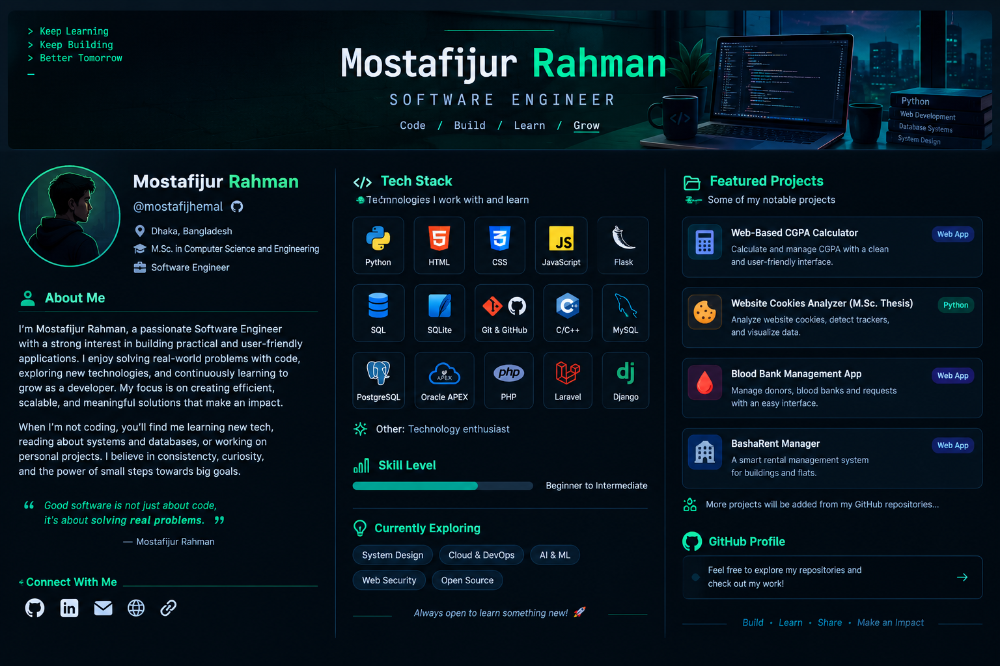

<!-- Add the generated banner image to the repository at assets/github-banner.png -->

# Hi, I'm Mostafijur Rahman 👋

### Software Engineer | CSE Postgraduate | Technology Enthusiast

*Building practical applications, solving real-world problems, and learning something new every day.*

---

## 👨‍💻 About Me

I'm **Mostafijur Rahman**, a Software Engineer with an academic background in **M.Sc. in Computer Science and Engineering**. I enjoy turning ideas into practical, user-friendly applications and exploring how software, databases, and thoughtful system design can solve everyday problems.

I work with technologies across Python development, web development, and database systems. I'm continuously improving my skills through hands-on projects, experimentation, and learning new tools. I value readable code, consistent learning, and building software that is useful to real people.

- 🔭 **Working on:** Personal and academic software projects
- 🌱 **Learning and exploring:** Web development, databases, software design, and new technologies
- 🧠 **Interested in:** Practical problem-solving, application development, and technology
- 📍 **Based in:** Dhaka, Bangladesh
- 🎓 **Education:** M.Sc. in Computer Science and Engineering
- ⚡ **Motto:** Build • Learn • Share • Make an Impact

---

## 🛠️ Tech Stack

### Languages

### Web & Frameworks

### Databases & Tools

> **Skill level:** Beginner to Intermediate. I keep learning by building, testing, and improving projects.

---

## 🚀 Featured Projects

### 1. Web-Based CGPA Calculator
A browser-based tool for calculating semester-wise and overall CGPA from course credits and grades.

**Focus:** HTML, CSS, JavaScript  
**Repository:** [Add repository link](https://github.com/mostafijhemal)

### 2. Website Cookies Analyzer — M.Sc. Thesis
A Python-based application concept for collecting and analyzing website cookies, with a focus on cookie properties, third-party cookies, and data visualization.

**Focus:** Python, Streamlit, SQLite, data analysis  
**Repository:** [Add repository link](https://github.com/mostafijhemal)

### 3. Blood Bank Management App
A planned platform concept to help donors, social organizations, and blood banks manage donor information and blood requests.

**Focus:** Application design, database design, workflow planning  
**Repository:** [Add repository link](https://github.com/mostafijhemal)

### 4. BashaRent Manager
A rental management application concept for organizing building, floor, flat, and rental information.

**Focus:** Web application development, data management, UI design  
**Repository:** [Add repository link](https://github.com/mostafijhemal)

> More projects will be added as I publish and update repositories on GitHub.

---

## 🌐 Connect With Me

- **GitHub:** [@mostafijhemal](https://github.com/mostafijhemal)
- **LinkedIn:** [Add your LinkedIn profile URL](https://www.linkedin.com/in/mostafij-hemal)
- **Email:** [Add your public contact email](mailto:mostafij.hemal@gmail.com)
- **Portfolio / Website:** [Add your website URL](https://example.com)
- **Other social profile:** [Add a profile link](https://example.com)

*Replace the placeholder links above with your real public profile URLs before publishing.*

---

### `> Keep Learning. Keep Building. Get Better.`

**Thanks for visiting my profile!** ⭐

